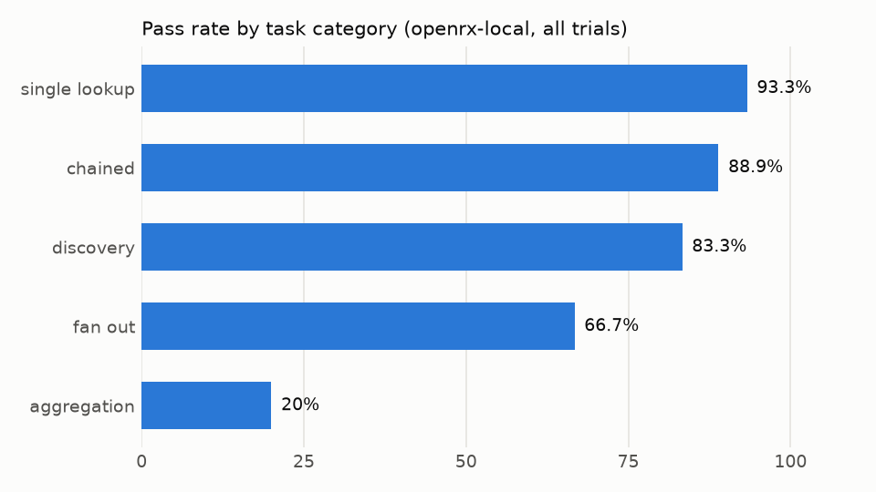
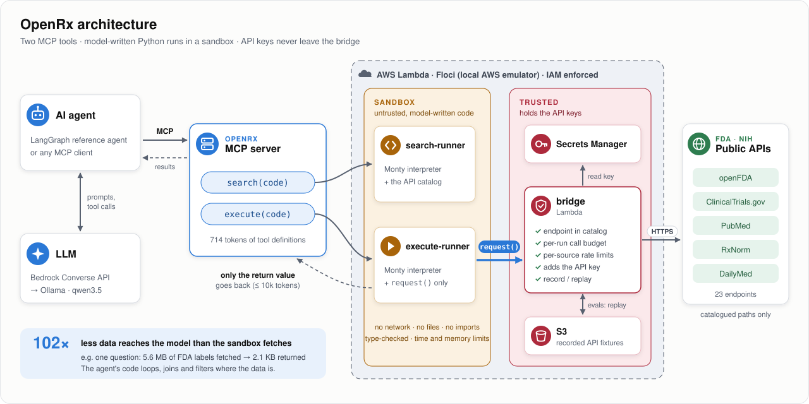

# OpenRx

[](https://github.com/pratyushmohit/openrx/actions/workflows/ci.yml)

[](LICENSE)
[](https://modelcontextprotocol.io)

**An MCP server that lets AI agents answer drug-safety questions by writing code against
five public FDA/NIH APIs, run in a sandbox, through just two tools.**

Most MCP servers expose one tool per API endpoint. Every tool definition costs context
tokens, and every intermediate result passes through the model. OpenRx instead gives the
agent `search` (find endpoints in a catalog) and `execute` (run Python that calls them).
The agent's code loops, joins and filters inside a sandbox; only the final answer reaches
the model. API keys never enter the sandbox.

Sources: **openFDA** (adverse events, labels, recalls, shortages, NDC),
**ClinicalTrials.gov**, **PubMed**, **RxNorm** and **DailyMed**, 23 endpoints in all.

## Results

Evaluated on 25 multi-step questions × 3 attempts (75 runs) with a local model
(qwen3.5 on Ollama), scored automatically against answers computed from the same data.

| | Result |
|---|---|
| **Context cost of the tools** | **714 tokens** for both tools, vs 4,549 for one tool per endpoint (6.4× smaller, and constant as endpoints are added) |
| **Data kept out of the model** | **102×** fewer bytes reached the model than the sandbox fetched (380× on fan-out questions) |
| **Answer accuracy** | **68%** correct on the first attempt, 71% over all runs (93% on single lookups, 89% on chained questions) |
| **Self-repair** | **81%** of failed code runs were fixed by the agent on its next try |
| **Hallucinated endpoints** | **1.1%** of API calls (the catalog rejects anything not in it) |
| **Reliability** | **0%** infrastructure errors and **0** timeouts across 456 tool calls |
| **Speed** | 18 s per question (p50), 80 s (p95); sandbox overhead **7 ms**, API bridge overhead **1.3 ms** |

Full tables: [`results/summary.md`](results/summary.md) · every failed run and why:
[`results/failures.md`](results/failures.md). The misses are mostly the small local model
running out of steps on counting questions; everything OpenRx itself controls met its
target ([details](docs/slos.md)).



## Architecture

<a href="https://raw.githubusercontent.com/pratyushmohit/openrx/main/docs/architecture.svg"></a>

<sub>Click the diagram to open it full size.</sub>

1. The agent calls `search` with Python to explore the API catalog, then `execute`
   with Python that fetches and processes the data.
2. The code runs in **[Pydantic Monty](https://github.com/pydantic/monty)**, a
   deny-by-default Python interpreter written in Rust: no filesystem, no network, no
   imports. Its only way out is `request()`.
3. `request()` goes to the **bridge** Lambda, which checks the call against the catalog,
   enforces a per-run budget and rate limits, adds the API key and calls the API, or
   replays a recorded response for reproducible evals.
4. Only the code's return value (capped at about 10k tokens) goes back to the model.

For example, asked *"Of pioglitazone, rosiglitazone and metformin, which have a boxed
warning on an FDA label?"*, the agent wrote this (condensed; it made one call per drug):

```python
for drug in ["pioglitazone", "rosiglitazone", "metformin"]:
    r = await request(
        "openfda",
        "/drug/label.json",
        {"search": f'openfda.generic_name:"{drug}" AND _exists_:boxed_warning', "limit": 10},
    )
    print(drug, r["status"])
```

It fetched 5.6 MB of labels; the model saw 2.1 KB.

More diagrams (an `execute` call step by step, the security boundaries):
[`docs/architecture.md`](docs/architecture.md).

## What I built

- **MCP server** (fastmcp): two tools, and a 714-token footprint enforced by a unit test.
- **Sandboxed runners** on AWS Lambda: Monty with a type check before every run, time
  and memory limits, and results trimmed to fit the context.
- **API bridge** Lambda: allow-list validation against the catalog, per-run call budget,
  per-source rate limits, keys from Secrets Manager, record/replay fixtures in S3.
- **API catalog**: 5 sources and 23 endpoints in YAML, with query guides, example
  responses and a linter; partly generated from OpenAPI specs.
- **Reference agent**: a LangGraph agent and `openrx ask "<question>"`.
- **Eval harness**: a 25-task suite, deterministic scorers, a runner that saves every
  trial, and a report of every metric in the design doc (accuracy, grounding, tokens,
  latency percentiles, error classes).
- **Infrastructure as code**: Terraform for every Lambda, IAM role, secret and bucket,
  run locally on [Floci](https://github.com/floci-io/floci) (an AWS emulator) with IAM
  enforced.
- **Quality**: 541 unit tests and 120 integration tests (92% coverage); ruff, pyright
  and CI on GitHub Actions; 17 design decisions recorded with their reasons.

**Stack:** Python 3.13 · MCP (fastmcp) · Pydantic Monty · AWS Lambda, S3, IAM, Secrets
Manager, Bedrock · Terraform · LangGraph · Ollama · Docker · uv · pytest

## Run it

Needs Docker, [uv](https://docs.astral.sh/uv/), Terraform and
[Ollama](https://ollama.com) with `qwen3.5` pulled.

```bash
uv sync
make up                     # start Floci (local AWS) in Docker
make deploy                 # build the Lambdas and apply Terraform
make fixtures-import        # load the recorded API data for the evals

uv run openrx ask "What are the 5 most reported adverse reactions for metformin?"
make serve                  # or connect any MCP client over stdio
make eval-run eval-report   # rerun the evals (about 35 minutes)
make check                  # lint, type check, unit tests (what CI runs)
```

`make help` lists every command.

## Docs

| | |
|---|---|
| [`docs/design.md`](docs/design.md) | Full design doc: requirements, metrics, architecture, alternatives, milestones |
| [`docs/architecture.md`](docs/architecture.md) | Diagrams: components, one `execute` call, security boundaries |
| [`docs/decisions.md`](docs/decisions.md) | 17 design decisions, each with the options considered and why |
| [`docs/slos.md`](docs/slos.md) | Latency targets, how they were set, and measured results |
| [`docs/m0-findings.md`](docs/m0-findings.md) | Spike results that shaped the design |
| [`docs/python-subset.md`](docs/python-subset.md) | The Python the sandbox supports |

## Limitations

- Evaluated with one local model; prompt tuning and a second model are not done.
- The sandbox relies on Monty's isolation plus IAM; there is no dedicated
  sandbox-escape test suite yet ([D-017](docs/decisions.md)).
- Runs on a local AWS emulator; it has not been deployed to real AWS.

## Credits

The search-and-execute idea comes from Cloudflare's
[Code Mode](https://blog.cloudflare.com/code-mode/) and Anthropic's
[Code execution with MCP](https://www.anthropic.com/engineering/code-execution-with-mcp).
OpenRx implements it in Python on AWS primitives and measures it on a real domain.
Data from public FDA and NIH APIs; not for medical decisions.

## License

[MIT](LICENSE)
