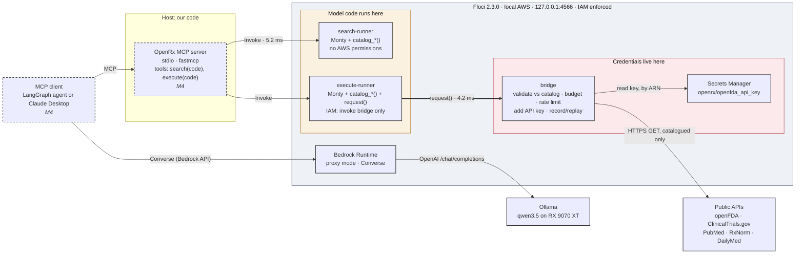
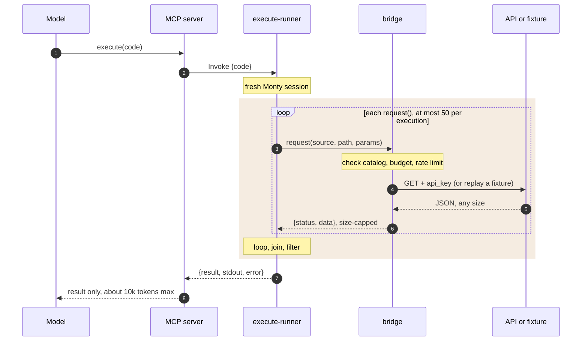
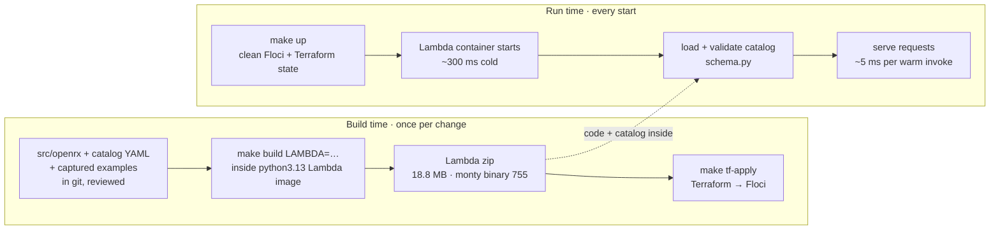

# Architecture

How OpenRx fits together: components and trust zones, the path of one `execute` call,
and what happens at build time vs run time. The design itself is in the README
(§7–§8); the reasons behind it are in [`decisions.md`](decisions.md); measured numbers
are in [`m0-findings.md`](m0-findings.md) and [`slos.md`](slos.md).

Keep this file in sync with the code: when a component is built, change its class from
`planned` to `built` in Figure 1 and update the status table.

## 1. Components and trust zones

Three zones matter. Our own code runs on the host. Model-written code runs only in the
runner Lambdas (D-005). Credentials exist only in the bridge and Secrets Manager. The
one path from the sandbox towards the credentials is `request()`, a single Lambda
invoke, and the bridge checks every request against the catalog.

Solid outline: built. Dashed: planned (milestone in italics). Latencies are M0
measurements on the reference machine (warm p50). On real AWS the runners have no route
to the internet; on Floci they do, so Monty is the enforced boundary locally (§4).

## 2. One `execute` call

The model sends code once and gets one small result back. Full API responses stay
inside the sandbox and the bridge, which is where the token savings come from (README
goal G2).

The shaded block is everything that never reaches the model's context. The budget of
50 calls is Monty's `max_suspensions` limit. In replay mode the bridge reads recorded
fixtures instead of calling the APIs, so evals are reproducible.

## 3. Build time and run time

The catalog YAML and its captured example responses (D-009) are committed and reviewed like code. It travels inside the package
into each Lambda zip (D-008) and is validated by `schema.py` every time a Lambda starts.
Nothing is regenerated at run time.

A broken catalog fails at `openrx catalog lint` before it is committed, and a Lambda
refuses to start with one rather than half-working.

## 4. Defence in depth

Each layer covers for another failing. Measured in M0 experiment E5 with Floci's IAM
enforcement on.

| Layer | Guarantee | On Floci | On real AWS |
|---|---|---|---|
| 1. Monty | Model code has no network, files, env vars or imports beyond our functions | Enforced | Enforced |
| 2. Lambda | Each run in its own container, away from the MCP server and host files | Enforced | Enforced |
| 3. IAM | Runner may only invoke the bridge; only the bridge may read the secret | Enforced, with known Floci gaps | By design |
| 4. VPC | Runner containers cannot reach the internet | **Not enforced** | By design |

## 5. Component status

| Component | Milestone | Status |
|---|---|---|
| Floci, Terraform env, Bedrock → Ollama | M0 | Built |
| Lambda build (`make build`) | M0 | Built |
| Package + CLI skeleton | M1 | Built |
| Catalog schema | M1 | Built |
| Catalog loader, lint, example capture | M1 | Built |
| Catalog sources: openFDA, PubMed, RxNorm, DailyMed, ClinicalTrials.gov (23 endpoints) | M1 | Built |
| `catalog_*()` functions | M1 | Built |
| Bridge (validation, keys, limits, record/replay, Lambda) | M2 | Built |
| search-runner | M3 | Built |
| execute-runner | M3 | Built |
| MCP server, LangGraph agent | M4 | Planned |
| Eval harness and report | M5 | Planned |
